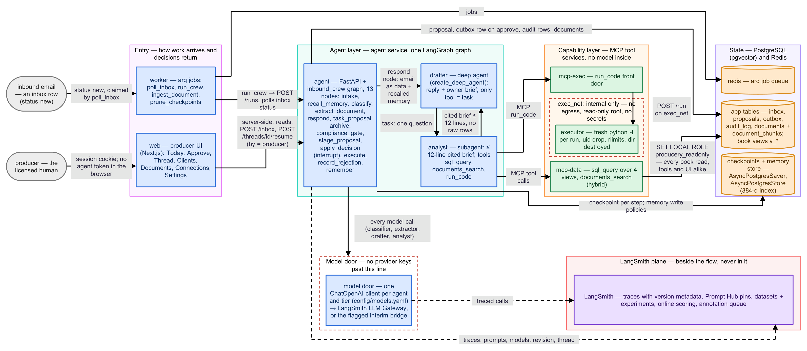

# Producery

Approval-gated inbound-operations agents for a small property and casualty insurance agency: every inbound email is
triaged, researched against the agency's book of business, drafted, and held until a licensed producer approves it.
Built with LangChain and LangGraph (Deep Agents), MCP tool services and a sealed code sandbox, with LangSmith as the
operational backbone for prompts, traces, evaluations and online scoring.



- **One graph, one pause.** The `inbound_crew` LangGraph graph carries an email through typed stages and stops with
  a dynamic `interrupt()` before any consequential action; the producer approves, edits or rejects.
- **Quarantined data access.** The drafter's only tool is `task`; an analyst subagent answers every data question
  with a cited brief of at most twelve lines, using `sql_query` over four read-only views, `documents_search` and
  `run_code` in a sealed executor.
- **One model door.** Every model call goes through the LangSmith LLM Gateway, or a flagged interim bridge, with
  static per-agent tiers and declared fallback chains; the application holds no provider key.
- **Pinned prompts, versioned traces.** Every prompt is a Prompt Hub commit pinned in `config/prompts.yaml`; every
  trace carries the prompt commits, model tiers, door and build sha that served it.
- **A gate that can fail.** Four datasets run through `langsmith.evaluate` with deterministic checks first; one
  pipeline definition runs locally and in CI, and proves the gate goes RED before trusting it.

## Quickstart

Prerequisites: Docker Desktop (Compose v2), Python 3.11, GNU `make`, and a LangSmith account (the free tier is
enough). On Windows use Git Bash with `make` installed, or run the recipe lines from the `Makefile` by hand; see
[Shell and Windows](docs/cookbook/README.md#shell-and-windows). Node 22 is needed only to develop the web UI outside
Docker; a logged-in Claude Code CLI only for the interim model door below.

```bash
git clone https://github.com/kfedorov17/producery-v1-demo.git && cd producery-v1-demo
cp .env.example .env
```

Open `.env` and set `LANGSMITH_API_KEY` (LangSmith → Settings → API keys, a workspace-scoped service key). Then
choose the model door, the one decision the first request depends on:

| Your organisation | What to do |
|---|---|
| has the LangSmith LLM Gateway enabled | keep the defaults (`MODEL_ACCESS_MODE=gateway`) |
| does not (free organisations: the first drafting turn fails with `403 LLM Gateway not enabled`) | set the three interim-door lines in `.env` and run `make bridge` on the host after setup; the steps are in [Run your first agent turn](docs/cookbook/first-turn.md#choose-the-model-door) |

```bash
make setup                      # creates .venv, installs the package, fills AGENT_API_TOKEN and SESSION_SECRET in .env
source .venv/Scripts/activate   # Git Bash on Windows; on Linux and macOS: source .venv/bin/activate
make prompts-push               # pushes the five prompts to your Prompt Hub and rewrites config/prompts.yaml with their commits
export REVISION_ID=$(git rev-parse --short HEAD)
docker compose up -d --build    # about 8 minutes the first time
curl -s localhost:8010/ready    # {"ok":true,...} once the stack is healthy
```

Every host-side command in the documentation assumes the activated venv (or the `.venv/Scripts/python` prefix the
Makefile uses). `make prompts-push` changes a tracked file: the pins in `config/prompts.yaml` now name commits in
your Hub, and `prompts-check` in CI holds the code to them, so commit the change.

**First request:** [Run your first agent turn](docs/cookbook/first-turn.md) sends an email in through the API or
the producer UI at `http://localhost:3010`, reads the proposal the graph pauses on, approves it and opens the trace.

## Documentation

| Document | Read this when… |
|---|---|
| [`docs/architecture.md`](docs/architecture.md) | you want the whole picture in five minutes: four diagrams and the components overview |
| [`docs/design.md`](docs/design.md) | you want the reasoning: graph, agents, tools, memory, prompts, model door, security boundaries |
| [`docs/cookbook/`](docs/cookbook/README.md) | you want to do something: first turn, add a tool or a subagent, change a prompt, memory, sandbox, evals, operate, deploy |
| [`docs/evals.md`](docs/evals.md), [`docs/pipeline.md`](docs/pipeline.md), [`docs/deployment.md`](docs/deployment.md) | evaluation design and gates; the CI/CD stages; compose today and the Kubernetes / LangSmith Deployment path |
| [`evals/README.md`](evals/README.md) | the evaluation package: plan, suite dataset, evaluators, runner, results |
| [`docs/friction-log.md`](docs/friction-log.md) | what was awkward in LangChain, LangGraph, Deep Agents and LangSmith on the way |

[`docs/README.md`](docs/README.md) is the index, with a repository map and one line per page on what it covers and
who it is for. Tests: `make test` (unit, seconds), `make lint`, `make typecheck`; the full stage as CI runs it is
`python scripts/pipeline.py ci`. See [`CONTRIBUTING.md`](CONTRIBUTING.md).
