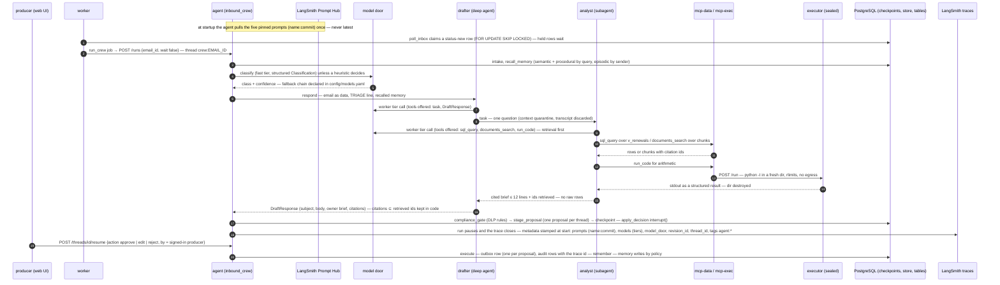
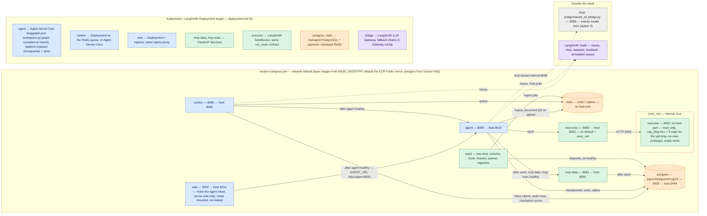

# Producery — architecture in four views

View 1 and the components table explain the system; views 2–4 add the request flow, the state model and the
deployment shape. Every box is a module, service or LangSmith capability that exists in the code or in
`docker-compose.yml`; names match the code so you can grep for them. The Mermaid source in `diagrams/*.mmd` is the
single source of truth for the diagrams below; `diagrams/view{1-system,2-request,3-state-memory,4-deployment}.{svg,png}`
are rendered copies.

## Legend (applies to all four views)

| Mark | Meaning |
|---|---|
| blue box | agent-side code: the graph, the deep agent and its subagent, the worker, the producer UI, the model door |
| green box | tool services and background jobs: MCP servers, the sealed executor, ingestion, pruning |
| orange cylinder | a store: PostgreSQL tables / views / checkpoints / memory index, Redis |
| purple box | the LangSmith plane: traces, Prompt Hub, datasets and experiments, online scoring, annotation queue |
| grey | outside the system: the inbound email, the producer, the host-side interim bridge, LangSmith SaaS |
| red dashed frame | a trust boundary: the sealed execution network, the "no provider keys past this line" model door |
| solid arrow | something travels on the serving path (the label says what) |
| dotted arrow | observability only: a trace or a Hub pull; nothing on the serving path depends on it |

Terms: **crew** = the `inbound_crew` LangGraph graph that handles one email; **proposal** = the single action the crew
wants to take (send a reply, create a task, update a record); **owner brief** = the producer-facing note with cited
figures; **door** = the one model endpoint every call goes through; **pin** = a Prompt Hub prompt referenced by
`name:commit`.

## View 1 — the system at one glance

Rendered: [view1-system.png](diagrams/view1-system.png) · [view1-system.svg](diagrams/view1-system.svg)

```mermaid
flowchart LR
  %% Legend (also in architecture.md): blue = agents and graph code, green = tool services, orange = stores,
  %% purple = LangSmith plane, grey = outside the system, red dashed = trust boundary.
  classDef agent fill:#dbe9ff,stroke:#2f6fdb,color:#0b2a5b
  classDef tool fill:#dcf5e3,stroke:#2e8b57,color:#0f3d22
  classDef store fill:#ffe9cc,stroke:#d98b1a,color:#4d2e00
  classDef ls fill:#ece0ff,stroke:#7a3fd1,color:#2d0f5c
  classDef ext fill:#eeeeee,stroke:#777,color:#222
  classDef boundary fill:none,stroke:#c0392b,stroke-dasharray:6 4

  email(["inbound email — an inbox row (status new)"]):::ext
  producer(["producer — the licensed human"]):::ext

  subgraph entry ["Entry — how work arrives and decisions return"]
    web["web — producer UI (Next.js): Today, Approve, Thread, Clients, Documents, Connections, Settings"]:::agent
    worker["worker — arq jobs: poll_inbox, run_crew, ingest_document, prune_checkpoints"]:::agent
  end

  subgraph agents ["Agent layer — agent service, one LangGraph graph"]
    agent["agent — FastAPI + inbound_crew graph, 13 nodes: intake, recall_memory, classify, extract_document, respond, task_proposal, archive, compliance_gate, stage_proposal, apply_decision (interrupt), execute, record_rejection, remember"]:::agent
    drafter["drafter — deep agent (create_deep_agent): reply + owner brief; only tool = task"]:::agent
    analyst["analyst — subagent: ≤ 12-line cited brief; tools sql_query, documents_search, run_code"]:::agent
  end

  subgraph caps ["Capability layer — MCP tool services, no model inside"]
    mcpdata["mcp-data — sql_query over 4 views, documents_search (hybrid)"]:::tool
    mcpexec["mcp-exec — run_code front door"]:::tool
    subgraph sealed ["exec_net: internal only — no egress, read-only root, no secrets"]
      executor["executor — fresh python -I per run, uid drop, rlimits, dir destroyed"]:::tool
    end
  end

  subgraph doorbox ["Model door — no provider keys past this line"]
    door["model door — one ChatOpenAI client per agent and tier (config/models.yaml) → LangSmith LLM Gateway, or the flagged interim bridge"]:::agent
  end

  subgraph state ["State — PostgreSQL (pgvector) and Redis"]
    tables[("app tables — inbox, proposals, outbox, audit_log, documents + document_chunks; book views v_*")]:::store
    ckpt[("checkpoints + memory store — AsyncPostgresSaver, AsyncPostgresStore (384-d index)")]:::store
    redis[("redis — arq job queue")]:::store
  end

  subgraph lsplane ["LangSmith plane — beside the flow, never in it"]
    langsmith["LangSmith — traces with version metadata, Prompt Hub pins, datasets + experiments, online scoring, annotation queue"]:::ls
  end

  email -->|"status new, claimed by poll_inbox"| worker
  producer -->|"session cookie; no agent token in the browser"| web
  web -->|"server-side: reads, POST /inbox, POST /threads/id/resume (by = producer)"| agent
  worker -->|"run_crew → POST /runs, polls inbox status"| agent
  worker -->|"jobs"| redis
  agent -->|"ingest_document job on upload"| redis
  agent -->|"respond node: email as data + recalled memory"| drafter
  drafter -->|"task: one question"| analyst
  analyst -->|"cited brief ≤ 12 lines, no raw rows"| drafter
  analyst -->|"MCP tool calls"| mcpdata
  analyst -->|"MCP run_code"| mcpexec
  mcpexec -->|"POST /run on exec_net"| executor
  agent -->|"every model call (classifier, extractor, drafter, analyst; the judge at eval time)"| door
  mcpdata -->|"SET LOCAL ROLE producery_readonly — every tool read of the book"| tables
  agent -->|"proposal, outbox row on approve, audit rows, documents; UI book reads as producery_readonly"| tables
  agent -->|"checkpoint per step; memory write policies"| ckpt
  door -.->|"traced calls"| langsmith
  agent -.->|"traces: prompts, models, revision, thread"| langsmith
  class sealed,doorbox boundary
```

## Components overview

| Component | What it does | Where it lives (service — code) | Key design decision |
|---|---|---|---|
| `inbound_crew` graph | Routes one inbound email through typed stages to exactly one proposal and pauses before any consequential action | agent — `producery/graphs/{state,nodes,crew}.py`, packaged by `langgraph.json` → `entrypoint.py:graph` | Dynamic `interrupt()` runs before any write in `apply_decision`; every side effect sits in the node before it |
| `classifier`, `extractor` | Single structured model calls: eight-class triage; declarations-page / agreement field extraction with confidences | agent — `nodes.py` `classify`, `extract_document`; Hub prompts `producery-classifier`, `producery-extractor` | Heuristics first; a failed or empty model answer degrades to a human triage task, never to the deep agent |
| `drafter` deep agent | Composes the client reply and the owner brief; delegates everything data-shaped | agent — `producery/agents/factory.py` → `create_deep_agent` | Zero data tools by construction; its only tool is `task`; an empty draft becomes a review task, never a send |
| `analyst` subagent | Answers one question with a cited brief of at most 12 lines using the three MCP tools | agent — `factory.py` `_subagent_spec`; Hub prompt `producery-analyst`; `RetrievalFirstMiddleware` | Context quarantine: raw rows never reach the drafter; the first move must be a tool call |
| `mcp-data` | `sql_query` over four allowlisted views, `documents_search` hybrid retrieval over chunks | mcp-data — `producery/mcp_data/server.py` (FastMCP, 8081) | No model inside a tool; every query runs as `producery_readonly` in a read-only transaction and teaches on rejection |
| `mcp-exec` + `executor` | `run_code`: Python in a fresh process per request, result as structured stdout/stderr/exit/timeout | mcp-exec + executor — `producery/mcp_exec/server.py`, `producery/executor/server.py` | The executor has no secrets and no egress (`exec_net internal: true`), drops to an unprivileged user, destroys the run directory |
| model door | One `ChatOpenAI` client per (agent, tier) aimed at the LangSmith LLM Gateway, or the flagged interim bridge | agent — `producery/model/door.py`, `config/models.yaml` | Static tier per agent, fallback chains declared not computed, every client tagged `agent:<name>` / `tier:<tier>`; no provider SDK or key in the app |
| Prompt Hub pins | Every prompt pulled once at startup by `name:commit` | agent — `producery/prompts/hub.py`, `config/prompts.yaml`, `prompts/*.yaml` | ANCHOR structure with a stable prefix; `latest` never resolves; a missing pin fails readiness |
| checkpoints | Per-step LangGraph checkpoints: the HITL pause and crash recovery | postgres — `AsyncPostgresSaver` wired in `producery/server/app.py` | Retention per thread class (crew 30 / eval 2 / smoke 1 days) by the worker's prune job |
| memory store | Semantic, episodic and procedural memory with vector search | postgres — `AsyncPostgresStore` + `producery/memory/store.py`, index `producery/memory/embed.py` (384-d, keyless) | Namespaced by agency and thread class; explicit write policies per kind; episodic TTL 180 days |
| app tables and book | Inbox, proposals, outbox, audit log, documents and chunks; the book as four views | postgres — `producery/store/{schema.sql,records.py}`, `fixtures/book.sql` | Idempotent writes: one proposal per thread, one outbox row per proposal, run claims; the book is reachable only through the read-only role |
| `worker` | Releases inbox mail to the crew, ingests documents, prunes checkpoints | worker — `producery/worker/main.py` (arq over Redis) | Bounded retries (`arq.Retry` 15 s / 30 s), then a `job_dead_letter` audit row; a failed turn is recorded as failed |
| `agent` API | `/runs`, `/threads/{id}/resume|continue|feedback`, `/ready`; the UI integration layer `/inbox`, `/proposals`, `/outbox`, `/book/{view}`, `/documents`, `/connections`, `/threads/{id}/audit` | agent — `producery/server/app.py`, `ui_api.py` (FastAPI, 8000) | Bearer token on every route but the probes; the UI layer adds reads and manual intake only, nothing new in the crew |
| `web` producer UI | Today, Approve (decision cards), Thread, Clients, Documents, Connections, Settings | web — `web/` (Next.js, 3000 → host 3010) | The browser never holds the agent token: a session-gated, allowlisted `/api/ui` proxy stamps every decision with the signed-in producer; only `crew:` threads are reachable |
| evals + gate | Datasets in the repo mirrored to LangSmith, `evaluate()` with deterministic checks first, a gate with no skip flag | host / CI — `producery/evals/*`, `evals/datasets/*.jsonl`, `config/eval_gates.yaml` | The gate proves it can fail on every run (`_gate_red_proof`) before the real suite; two judge rows only |
| LangSmith plane | Traces stamped with agent@version, prompt commits, model tiers, build sha; Hub; experiments; feedback; annotation queue; online scoring | LangSmith — `CrewDeps.trace_metadata`, `producery/evals/online.py` | Observability sits beside the flow: nothing on the serving path depends on it |

## View 2 — one request, end to end

Rendered: [view2-request.png](diagrams/view2-request.png) · [view2-request.svg](diagrams/view2-request.svg)

### Walkthrough (the step numbers are the diagram's)

1. The worker claims a `new` inbox row with `FOR UPDATE SKIP LOCKED` — one run per email across instances; only rows with status `new` are claimed (seeded fixtures start as `held`).
2. The `run_crew` job starts the crew on thread `crew:<email id>` through `POST /runs` (202) and polls the inbox row's status; a redelivery resumes from the checkpoint instead of starting over.
3. `intake` and `recall_memory` load the email and the three memory kinds for this sender and question.
4. `classify` is a structured call on the fast tier unless a heuristic (known client, a configured rule, a carrier or network domain) already decided; personal mail is always the model's call.
5. The door returns the class; the fallback chain for the tier comes from `config/models.yaml`, not from code.
6. `respond` hands the drafter the email as data, the triage line and the recalled memory.
7. The drafter's model call offers exactly two tools: `task` and the `DraftResponse` schema.
8. It delegates the data question to the analyst; the analyst's transcript never enters the drafter's context.
9. The analyst's model call offers exactly `sql_query`, `documents_search`, `run_code`; the retrieval-first guard makes the first move a tool call.
10. `sql_query` runs over the allowlisted views as the read-only role; `documents_search` over the document chunks.
11. Rows or chunks come back with the ids the brief must cite.
12. Arithmetic goes to `run_code`, never to the model.
13. The executor runs the snippet as a fresh unprivileged process with rlimits and no network.
14. The result returns as structured stdout; the run directory is destroyed.
15. The analyst returns a cited brief of at most 12 lines and the ids it retrieved — no raw rows.
16. The drafter returns the structured draft; citations that the tools did not return this turn are dropped in code.
17. The compliance gate applies the DLP rules, `stage_proposal` writes the one proposal, the checkpoint lands, and `apply_decision` pauses with `interrupt()`.
18. The run pauses and its trace closes in LangSmith; the metadata was stamped when the run started: prompt commits, model tiers, the door, the build sha, the thread, per-agent tags.
19. The producer decides in the UI (or the CLI); the proxy stamps `by` with the signed-in name and the graph resumes with `Command(resume=…)`.
20. `execute` writes the outbox row (one per proposal) and the audit rows with the trace id; `remember` writes memory by policy.

## View 3 — state and memory

Rendered: [view3-state-memory.png](diagrams/view3-state-memory.png) · [view3-state-memory.svg](diagrams/view3-state-memory.svg)

```mermaid
flowchart TB
  classDef agent fill:#dbe9ff,stroke:#2f6fdb,color:#0b2a5b
  classDef tool fill:#dcf5e3,stroke:#2e8b57,color:#0f3d22
  classDef store fill:#ffe9cc,stroke:#d98b1a,color:#4d2e00
  classDef ext fill:#eeeeee,stroke:#777,color:#222

  subgraph pg ["PostgreSQL + pgvector — one database, three roles of data"]
    ckpt[("checkpoints — AsyncPostgresSaver, one per graph step; thread id crew:ID, eval:ID or smoke:ID")]:::store
    store[("memory store — AsyncPostgresStore, index on text, 384-d fastembed, namespace memory.KIND.AGENCY.CLASS")]:::store
    tables[("app tables — inbox, proposals, outbox, audit_log, run_claims, ui_connections")]:::store
    docs[("documents + document_chunks — body by content hash, chunk embeddings")]:::store
    book[("book views — v_households, v_policies, v_renewals, v_appointments (producery_readonly)")]:::store
  end
  redis[("redis — arq queue: run_crew, ingest_document, prune_checkpoints")]:::store

  subgraph hot ["Hot path writes — inside a graph turn"]
    execute["execute — on approve or edit: outbox row, proposal executed exactly once"]:::agent
    decide["apply_decision / record_rejection — the human decision, recorded on the proposal"]:::agent
    remember["remember — episodic on every outcome; semantic from an executed record update or an approved reply (confidence, source = proposal id); procedural from a human edit or reasoned reject"]:::agent
    steps["every node — checkpoint write; stage_proposal → proposals; audit rows with trace id"]:::agent
  end

  subgraph read ["Read path — retrieval into context"]
    recall["recall_memory — semantic + procedural by query, episodic by sender (limit 5 / 5 / 3)"]:::agent
    analystq["analyst via mcp-data — sql_query (views only), documents_search (chunks)"]:::tool
  end

  subgraph bg ["Background — worker jobs and the store sweeper"]
    ingest["ingest_document — chunk + embed, idempotent by content hash (seed, UI upload)"]:::tool
    prune["prune_checkpoints — daily: crew 30 d, eval 2 d, smoke 1 d (config/retention.yaml)"]:::tool
    sweep["store TTL sweeper (runs in the agent process) — episodic 180 d; semantic and procedural never expire"]:::tool
  end

  execute -->|"outbox, proposals"| tables
  decide -->|"proposal status + reason, audit_log"| tables
  remember -->|"facts, preferences, episodes"| store
  steps -->|"checkpoints"| ckpt
  steps -->|"proposals, audit_log"| tables
  recall -->|"asearch"| store
  analystq -->|"read-only transaction"| book
  analystq -->|"hybrid search"| docs
  ingest -->|"chunks"| docs
  ingest -->|"job"| redis
  prune -->|"delete by class"| ckpt
  sweep -->|"expire"| store
```

## View 4 — deployment: compose today, Kubernetes / LangSmith Deployment target

Rendered: [view4-deployment.png](diagrams/view4-deployment.png) · [view4-deployment.svg](diagrams/view4-deployment.svg)

## Why it is shaped this way

**Subagent quarantine.** The drafter writes to a client and must never see a raw row or a query result it could
misquote; the analyst sees data and must never write to a client. Deep Agents' `task` delegation gives the drafter
a bounded, cited brief and discards the analyst's transcript, so the only thing that crosses the line is twelve
lines with citations — and the code keeps only citations the tools actually returned this turn. The analyst is
the only agent granted `run_code`, so arithmetic is computed, not estimated.

**The single model door.** Every model call — classifier, extractor, drafter, analyst, judge — goes through one
OpenAI-compatible client per (agent, tier) pointed at the LangSmith LLM Gateway, with the fallback chain declared in
`config/models.yaml`. The application holds no provider SDK and no provider key; traces carry which door served the
call. When the Gateway is not enabled on an org, the same client points at a flagged interim bridge on the host and
`/ready` says so; nothing in the agents changes.

**Memory write gating.** Each memory kind has one write path. Semantic facts are written only from executed record
updates, with the extractor's per-field confidence and the proposal id as source. Procedural preferences are written
only from a human's edit or reasoned rejection, never from the model's own output. Episodic memory records every
terminal outcome, with the sender withheld for personal mail, and expires after 180 days. Evaluation threads live in
their own namespace, so an eval can never teach production.
